  

  
  
  

## Sobre

Desenvolvedor **back-end júnior** com foco em **IA aplicada**. Construo APIs em Python e Java, sistemas com RAG e LLMs locais, e automações que vão do problema ao deploy, com testes, CI e as decisões técnicas documentadas.

Engenharia de Software na Universidade de Vassouras (5º período, conclusão em 2028) · Armação dos Búzios, RJ · **Aberto a vagas e estágios em back-end, automação e IA.**

## Em números

- **Acerto@4 de 73% e MRR 0,70** na busca do meu assistente RAG, medidos em um conjunto de avaliação próprio
- **MAE 83% menor** que a referência semanal na previsão de demanda (benchmark sintético)
- **55 testes** e 7 releases na calculadora hidráulica, publicada na nuvem
- CI no GitHub Actions em todos os projetos principais; deploy em servidor Ubuntu próprio e na nuvem (Discloud)

## Projetos em destaque

### [Assistente de Estudos com IA](https://github.com/LucasSMFerreira/assistente-estudos) · RAG
Responde perguntas sobre os PDFs da faculdade e cita o documento e a página da resposta. Tudo roda com modelos abertos, sem custo.
- Ingestão de PDF → embeddings (`nomic-embed-text`) → PostgreSQL + **pgvector** (índice HNSW) → resposta com **Ollama** (`qwen2.5`)
- Experimentos de tamanho e sobreposição de trecho comparados por Acerto@4 e MRR
- **FastAPI**, Docker Compose, pytest com mocks, CI e deploy automático em homelab (runner self-hosted + Tailscale)

### [Calculadora de Comprimento Equivalente](https://github.com/LucasSMFerreira/calc-comprimento-equivalente) · [demo ao vivo](https://calc-hidraulica.discloud.dev)
Calcula a perda de carga de tubulações e gera o memorial em PDF. Trabalho de Fenômenos de Transporte que virou produto.
- **FastAPI** com arquitetura em camadas (domínio, dados, entrada, relatório) e cálculo com `Decimal`
- Entrada por texto livre interpretada por **LLM local** atrás de um serviço com token; **a IA só interpreta, nunca calcula**, e o usuário confirma antes
- Tabela base versionada em SQLite com prévia de mudanças; validado contra o gabarito da disciplina; fluxo com issues, PRs e releases

### [Previsão de Demanda e Planejamento de Estoque](https://github.com/LucasSMFerreira/previsao-vendas-estoque) · ML
- Random Forest e XGBoost comparados com uma referência ingênua; MAE 83% menor no cenário sintético
- PostgreSQL/TimescaleDB, SQLAlchemy, Streamlit multiusuário com senhas em scrypt, bloqueio e expiração de sessão
- CI com banco real descartável

### [Data Remo API](https://github.com/LucasSMFerreira/data-remo-api) · Java
- API REST para atletas, treinos, ranking e resumo mensal de remo: **11 endpoints**, Java 21, Spring Boot, Spring Data JPA, PostgreSQL e Flyway
- Parte do projeto Data-Remo da faculdade, que recebe a telemetria de um ESP32 instalado no barco

<b>Mais projetos</b>

- [Reposição de Estoque](https://github.com/LucasSMFerreira/reposicao-estoque): quando e quanto comprar, respeitando compra mínima e múltiplos do fornecedor. Python puro, Tkinter e testes.
- [Radar de Vagas](https://github.com/LucasSMFerreira/radar-vagas) *(em construção)*: coleta vagas, ranqueia pela aderência ao meu perfil com embeddings e envia as melhores no Telegram.

## Stack

| Área | Ferramentas |
| --- | --- |
| Linguagens | Python · Java · SQL · JavaScript · HTML/CSS |
| Back-end e APIs | FastAPI · Pydantic · Spring Boot · Spring Data JPA · REST |
| Dados | PostgreSQL · pgvector · TimescaleDB · SQLAlchemy · SQLite |
| IA e ML | RAG · embeddings · Ollama · Qwen 2.5 · scikit-learn · XGBoost · pandas |
| Qualidade | pytest · Ruff · GitHub Actions · CI/CD |
| Infra | Docker · Docker Compose · Ubuntu Server · Tailscale · SSH · Discloud |

  
  
  
  
  
  
  
  

## Trilhas de projetos

Cada trilha é um projeto completo, do problema ao deploy, com testes e CI.

| Trilha | Projeto | Status |
| --- | --- | --- |
| 1 | [Assistente de Estudos com IA](https://github.com/LucasSMFerreira/assistente-estudos): RAG com avaliação medida | ✅ Concluída |
| 2 | [Radar de Vagas com IA](https://github.com/LucasSMFerreira/radar-vagas): coleta, embeddings e alertas no Telegram | 🔄 Em andamento |
| 3 | [Calculadora FENTRANS](https://github.com/LucasSMFerreira/calc-comprimento-equivalente): FastAPI, LLM local e memorial em PDF | 🏁 Reta final |
| 4 | Triagem Inteligente | ⏭️ Próxima |
| 5 | PromptLab | 📋 Planejada |

Direção: **AI Engineer**, com integração a APIs de LLM, agentes com ferramentas (tool calling) e avaliação de respostas.

## Além do código

- **Orquestra**: ferramenta comercial que gera sites com IA usando menos tokens, com vendas e licenças automatizadas por bots no Discord
- Fundador da **SmartShop**; automação de operações com bots em nuvem; formação certificada em **Scrum**

  Aberto a oportunidades em back-end, automação e IA · <a href="mailto:lucas.martins.bz@gmail.com">lucas.martins.bz@gmail.com</a>

