<!-- ========================= BANNER ========================= -->

  

  

  
  
  

 

<!-- ========================= SOBRE ========================= -->

<!-- ========================= DIAGNÓSTICO ========================= -->

<!-- ========================= MÓDULOS / FERRAMENTAS ========================= -->

  
  
  
  
  
  
  
  
  
  
  
  
  
  

 

<!-- ========================= TELEMETRIA ========================= -->

<!-- ========================= PROJETOS ========================= -->

<!-- ========================= LIDERANÇA ========================= -->

<!-- ========================= JORNADA ========================= -->

 

<!-- ========================= RODAPÉ ========================= -->

  

  
  

Versão em texto

**Lucas Martins Ferreira** — Desenvolvedor Back-end | Python · Java · SQL · IA e Automação
Engenharia de Software — Universidade de Vassouras (5º período) · Armação dos Búzios, RJ

Desenvolvo sistemas para apoiar decisões de estoque, organizar dados e automatizar operações. Conduzo projetos da definição do problema à implementação, com testes e documentação das decisões técnicas.

- **Linguagens:** Python · Java · SQL · HTML · CSS · JavaScript.
- **Back-end e APIs:** FastAPI · Pydantic · Uvicorn · Spring Boot · Spring Data JPA · APIs REST.
- **Dados e persistência:** PostgreSQL · pgvector · TimescaleDB · SQLAlchemy.
- **IA e Machine Learning:** Ollama · RAG · embeddings · nomic-embed-text · Qwen 2.5 · scikit-learn · XGBoost · pandas.
- **Interfaces:** Streamlit · Tkinter.
- **Qualidade e entrega:** pytest · unittest · Ruff · Git · GitHub Actions · CI/CD.
- **Infraestrutura:** Docker · Docker Compose · Ubuntu Server · Tailscale · SSH · runner self-hosted.

Projetos: [Assistente de Estudos com IA](https://github.com/LucasSMFerreira/assistente-estudos) · [Previsão de Demanda](https://github.com/LucasSMFerreira/previsao-vendas-estoque) · [Reposição de Estoque](https://github.com/LucasSMFerreira/reposicao-estoque) · [Data Remo API](https://github.com/LucasSMFerreira/data-remo-api)

